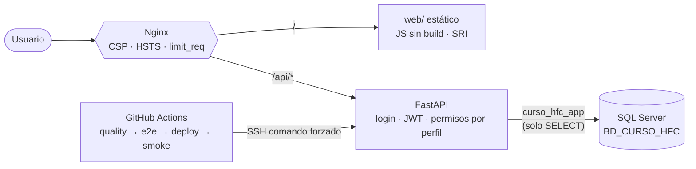

# Panel de Gestión HFC — una sola verdad para la operación

[](https://github.com/jdavilao21/curso-hfc/actions/workflows/ci-cd.yml)


**Demo:** https://curso-hfc.metadatape.com · datos **ficticios**

| Perfil | Usuario | Contraseña | Qué ve |
|---|---|---|---|
| Administrador | `ADMIN.DEMO` | `Admin#Hfc2026` | todo |
| Supervisor | `SUP.DEMO` | `Super#Hfc2026` | todo, con detalle por asesor |
| Cliente Claro | `CLIENTE.DEMO` | `Cliente#Hfc2026` | totales por supervisor, **sin** detalle por asesor |

Las contraseñas son públicas a propósito: la demo solo lee datos inventados y la base se regenera
en cada deploy. Tras 5 intentos fallidos en 15 minutos, el login se bloquea un rato (`429`).

En la campaña HFC (atención inbound de Claro Perú, operada por GEA Internacional), los
indicadores se armaban a mano en Excel: llegaban a media mañana y dos analistas podían dar dos
cifras distintas del mismo TNPS. Este panel muestra el nivel de servicio, el TMG, el TNPS y la
ocupación por **día, franja de 30 minutos, supervisor y asesor**, con el mismo cálculo para todos.

> Proyecto integrador del curso **Desarrollo AI-First con Claude**. Versión pública del tablero
> que la Jefatura de Planificación y Métricas usa en producción, rehecha con el pipeline
> documental (PRD → Design → Tech Design + ADRs → Backlog → Specs → Diagramas → Testing →
> Seguridad → Deploy) y con datos inventados.

## Qué hace

- **Ingreso por perfiles**: Administrador, Supervisor y Cliente Claro. El cliente no recibe el
  detalle por asesor, **ni siquiera llamando a la API directo**.
- **Diario**: 9 tarjetas KPI con semáforo contra la meta y sparkline, tabla por día, período,
  semana y rango.
- **Intervalos**: los mismos KPI por franja de 30 minutos, con gráficos.
- **Supervisores** y **Asesores**: producción, TNPS, CAT, TMG, horas y transferencias, con
  filtros de supervisor, coordinador, condición laboral, modalidad y contrato.
- **Excel** de cada tabla, firmado por el área. Temas noche, día, iOS y neón; **Modo TV**.

## Arquitectura



| Capa | Tecnología | Decisión |
|---|---|---|
| Front | HTML + JS (Chart.js, xlsx-js-style por CDN con SRI) | [ADR-0004](docs/03-arquitectura/adrs/0004-front-estatico-mismo-origen.md) |
| API | FastAPI + pyodbc, caché 60 s | [ADR-0003](docs/03-arquitectura/adrs/0003-contrato-api-post-estilo-webhook.md), [ADR-0006](docs/03-arquitectura/adrs/0006-api-fastapi-cache-memoria.md) |
| Datos | SQL Server, base y logins propios, semilla determinista | [ADR-0001](docs/03-arquitectura/adrs/0001-persistencia-sql-server-bd-propia.md), [0002](docs/03-arquitectura/adrs/0002-modelo-datos-grano-agregado.md), [0007](docs/03-arquitectura/adrs/0007-datos-ficticios-semilla-fija.md) |
| Seguridad | PBKDF2 + JWT HS256, permisos en el servidor, límite de intentos | [ADR-0005](docs/03-arquitectura/adrs/0005-autenticacion-propia-pbkdf2-jwt.md), [0009](docs/03-arquitectura/adrs/0009-autorizacion-por-perfil-en-servidor.md), [0010](docs/03-arquitectura/adrs/0010-limite-intentos-login.md) |
| Deploy | VPS Ubuntu, Nginx + systemd, GitHub Actions | [ADR-0008](docs/03-arquitectura/adrs/0008-despliegue-vps-nginx-systemd.md), [DEPLOY-PLAN](docs/09-deploy/DEPLOY-PLAN.md) |

## Cómo se construyó: el pipeline documental

| # | Paso | Documento |
|---|---|---|
| 01 | PRD | [`docs/01-producto/PRD.md`](docs/01-producto/PRD.md) |
| 02 | Design | [`docs/02-diseno/DESIGN.md`](docs/02-diseno/DESIGN.md) |
| 03 | Tech Design + ADRs | [`TECH-DESIGN-v1`](docs/03-arquitectura/TECH-DESIGN-v1.md) → revisión adversarial (15 hallazgos) → [`TECH-DESIGN` v2](docs/03-arquitectura/TECH-DESIGN.md) · [10 ADRs](docs/03-arquitectura/adrs/) |
| 04 | Backlog | [`docs/04-backlog/BACKLOG.md`](docs/04-backlog/BACKLOG.md) |
| 05 | Specs | [`openspec/`](openspec/) · [puente](docs/05-specs/README.md) |
| 06 | Diagramas | [`docs/06-diagramas/`](docs/06-diagramas/) |
| 07 | Testing | 25 E2E + 9 unitarios · [`docs/07-testing/`](docs/07-testing/README.md) |
| 08 | Seguridad | [`SECURITY-REPORT.md`](docs/08-seguridad/SECURITY-REPORT.md) (SP-01…SP-11) |
| 09 | Deploy | [`DEPLOY-PLAN.md`](docs/09-deploy/DEPLOY-PLAN.md) + [`ci-cd.yml`](.github/workflows/ci-cd.yml) |

El índice completo, con la trazabilidad de un requisito de punta a punta, está en
[`docs/README.md`](docs/README.md).

## Correr en local

```bash
# 1. SQL Server desechable
docker run -d --name hfc-sql -e ACCEPT_EULA=Y -e MSSQL_SA_PASSWORD='Una#Clave2026' \
  -p 127.0.0.1:14333:1433 mcr.microsoft.com/mssql/server:2022-latest
sqlcmd -S 127.0.0.1,14333 -U sa -C -i sql/01_crear_bd.sql -v CLAVE_APP='App#Local2026' CLAVE_CARGA='Carga#Local2026'

# 2. Dependencias y datos
python3 -m venv venv && venv/bin/pip install -r api/requirements.txt pytest
export DB_PORT=14333 CLAVE_ADMIN='Admin#Local2026' CLAVE_SUPERVISOR='Super#Local2026' CLAVE_CLIENTE='Cliente#Local2026'
DB_USER=curso_hfc_carga DB_PASSWORD='Carga#Local2026' venv/bin/python sql/semilla.py

# 3. API + web en http://127.0.0.1:8077 (entra con SUP.DEMO / Super#Local2026)
export DB_USER=curso_hfc_app DB_PASSWORD='App#Local2026' JWT_SECRET=$(python3 -c "import secrets;print(secrets.token_urlsafe(48))")
(cd api && SERVIR_WEB=1 ../venv/bin/uvicorn main:app --port 8077)

# 4. Tests
(cd api && ../venv/bin/python -m pytest -q)
npm ci && npx playwright install chromium && PYTHON=venv/bin/python npm run test:e2e
```

## Estructura

```
web/        front estático (index.html, css/, js/, assets/)
api/        FastAPI: main.py · auth.py · db.py · tests/
sql/        01_crear_bd.sql · 02_esquema.sql · semilla.py
tests/      Playwright E2E
deploy/     desplegar.sh · curso-hfc-api.service · nginx-curso-hfc.conf · crear-bd.sh · preparar-vps.sh · terminar-vps.sh
docs/       pipeline 01…09          openspec/   specs vigentes y changes
.claude/    agentes del proyecto     skills/     skill agregar-kpi-hfc
```

---
Jefatura de Planificación y Métricas · GEA Internacional
