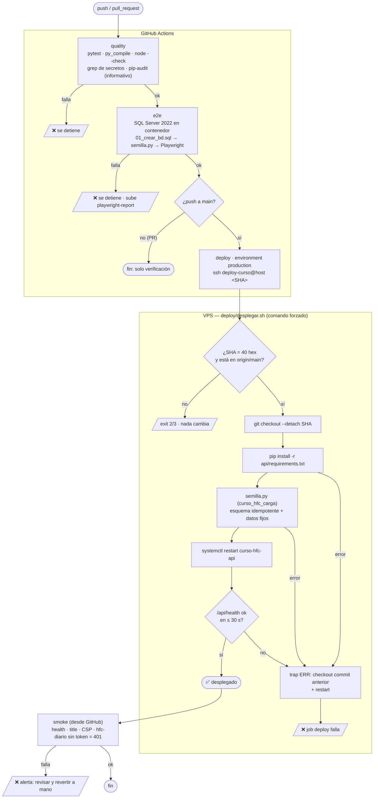

# CI/CD y despliegue — flujo (v1.0.0)

## Historial

| Versión | Fecha | Cambio |
|---|---|---|
| 1.0.0 | 2026-10-26 | Versión inicial: cuatro jobs, comando forzado por SSH y rollback automático |

