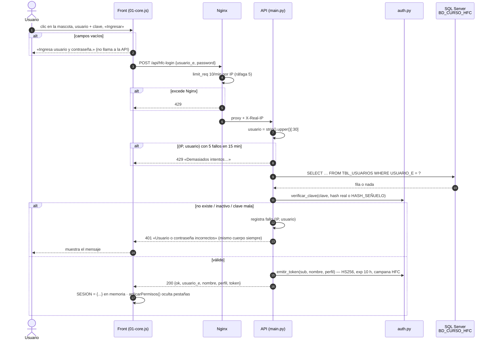
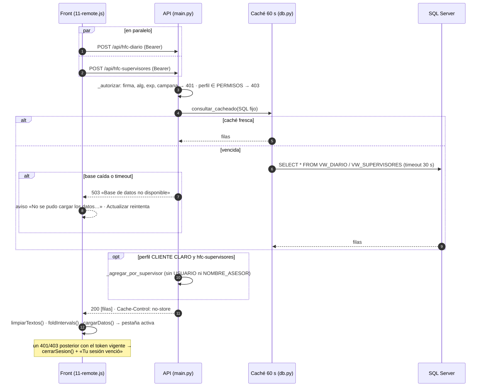

# Ingreso y carga del tablero — secuencia (v1.0.0)

## Historial

| Versión | Fecha | Cambio |
|---|---|---|
| 1.0.0 | 2026-10-26 | Versión inicial: login con límite de intentos, token HS256, carga en paralelo y agregado para CLIENTE CLARO |

## Ingreso

## Carga de datos

