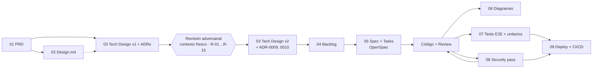

# Documentación — pipeline AI-First

Esta carpeta está ordenada en el mismo orden en que se trabajó el proyecto. Cada paso
**consume el documento anterior**: si el PRD cambia, el diseño técnico, el backlog y las specs
tienen que responder a ese cambio.

> **Nota honesta sobre el origen.** El Panel HFC existe en producción desde el 08-oct-2026 y se
> construyó iterando directamente con Jose. Este repositorio es su **versión del curso**: se
> partió del PRD y se rehízo el backend completo (base, API, login, permisos, despliegue) siguiendo
> el pipeline, reutilizando del sistema real solo el front y las fórmulas de los KPI. La revisión
> adversarial y el security pass se hicieron de verdad sobre esta versión y cambiaron el código.

## Los pasos

| # | Carpeta | Artefacto | Cómo se generó | Consume |
|---|---|---|---|---|
| 01 | [`01-producto/`](01-producto/) | [`PRD.md`](01-producto/PRD.md) | Entrevista sobre el problema real de la Jefatura (reportes manuales, cifras distintas) | La operación HFC |
| 02 | [`02-diseno/`](02-diseno/) | [`DESIGN.md`](02-diseno/DESIGN.md) | Extraído de los tokens reales de `web/css/` | PRD |
| 03 | [`03-arquitectura/`](03-arquitectura/) | [`TECH-DESIGN-v1.md`](03-arquitectura/TECH-DESIGN-v1.md) → [`TECH-DESIGN.md`](03-arquitectura/TECH-DESIGN.md) + [`adrs/`](03-arquitectura/adrs/) | Diseño decisión por decisión + **revisión adversarial con un agente que solo leyó PRD y v1** | PRD (+ DESIGN) |
| 04 | [`04-backlog/`](04-backlog/) | [`BACKLOG.md`](04-backlog/BACKLOG.md) | 6 ítems ordenados por dependencias | PRD + TECH-DESIGN v2 + ADRs |
| 05 | [`05-specs/`](05-specs/) | [`openspec/`](../openspec/) (en la raíz) | Un change por ítem: proposal → design → tasks → spec | Un ítem del BACKLOG |
| 06 | [`06-diagramas/`](06-diagramas/) | Secuencia de ingreso/carga y flujo de CI/CD | Mermaid, sobre el código real (fuentes citadas en cada diagrama) | Código |
| 07 | [`07-testing/`](07-testing/) | [`tests/`](../tests/) + [`api/tests/`](../api/tests/) | Un test por criterio de éxito / caso borde / hallazgo | PRD + revisión + security |
| 08 | [`08-seguridad/`](08-seguridad/) | [`SECURITY-REPORT.md`](08-seguridad/SECURITY-REPORT.md) | Security pass con evidencia; las correcciones volvieron al código | Código + TECH-DESIGN |
| 09 | [`09-deploy/`](09-deploy/) | [`DEPLOY-PLAN.md`](09-deploy/DEPLOY-PLAN.md) + [`ci-cd.yml`](../.github/workflows/ci-cd.yml) | Diseñado antes de ejecutar; cada cambio al VPS requiere autorización | Código + tests + SECURITY-REPORT |

En la raíz quedan los archivos que leen las herramientas: [`CLAUDE.md`](../CLAUDE.md) (contexto
y reglas para el agente), [`.claude/agents/`](../.claude/agents/) (developer, spec-owner,
code-reviewer), [`skills/`](../skills/) y [`README.md`](../README.md) (portada).

## Trazabilidad: cómo un documento "responde" al anterior

Un ejemplo real de este repo, de punta a punta:

1. **PRD**, criterio de éxito 3: *«El perfil Cliente Claro no puede ver el detalle por asesor
   desde la interfaz.»*
2. **TECH-DESIGN v1**: lo resolvía ocultando la pestaña en el front (`TABS_POR_PERFIL`).
3. **Revisión adversarial**, R-01 (ALTA): *«Con abrir DevTools, el cliente ve el detalle por
   asesor: la API le manda la vista completa.»*
4. **TECH-DESIGN v2** → [ADR-0009](03-arquitectura/adrs/0009-autorizacion-por-perfil-en-servidor.md):
   la API agrega por supervisor según el perfil del token.
5. **BACKLOG** ítem #4 → **OpenSpec** change
   [`2026-10-26-endpoints-datos-autorizacion`](../openspec/changes/archive/2026-10-26-endpoints-datos-autorizacion/)
   → spec vigente [`api-datos`](../openspec/specs/api-datos/spec.md), requisito *«Sin detalle por
   asesor para CLIENTE CLARO»*.
6. **Código**: `_agregar_por_supervisor` en `api/main.py`.
7. **Test**: `tests/api-seguridad.spec.js` → *«CLIENTE CLARO recibe Supervisores agregado, sin
   detalle por asesor»* (sin nombres y con los mismos totales).
8. **SECURITY-REPORT**: SP-04, corregido con esa evidencia.
